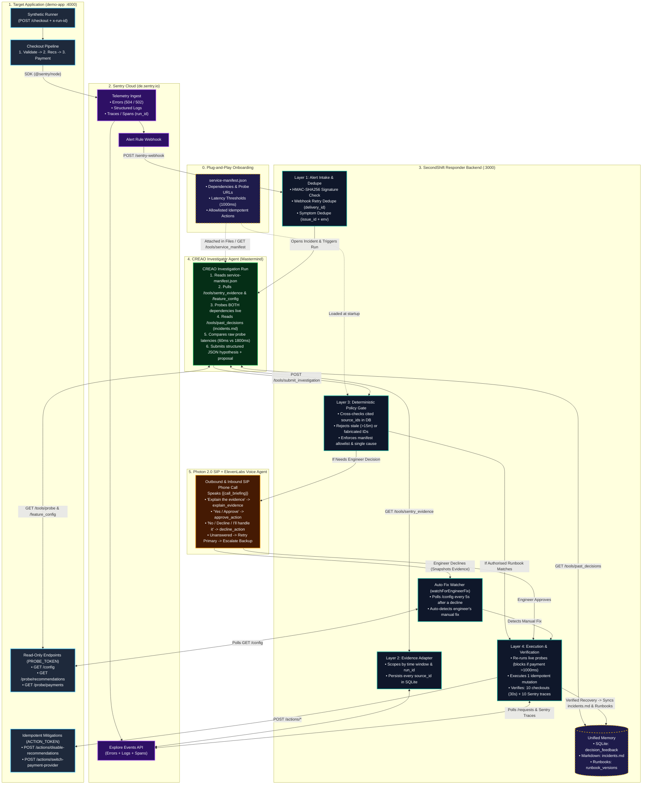

# SecondShift (Midnight Commander)

> **Fix 3 AM production outages without leaving bed:** A plug-and-play AI on-call engineer that diagnoses **Sentry** alerts via **CREAO**, calls your phone over **Photon 2.0 + ElevenLabs** to approve a safe fix from bed, proves real recovery, and learns every time you say *"No."*

Built at **LA Hacks 2026** with **CREAO** · **Sentry** · **Photon 2.0** · **ElevenLabs** · **Devin (Cognition)**.

---

## Why SecondShift?

When production breaks at 3:00 AM, on-call engineers have to drag themselves out of bed, open a laptop, and dig through dashboards while requests are failing. Worse, surface-level logs often mislead: a downstream feature timing out (`504`) might actually be the victim of a slow upstream payment provider saturating a shared connection pool.

**SecondShift** turns a 3 AM wake-up into a **20-second phone call**:
1. **Investigates before you pick up:** Pulls live **Sentry** errors, structured logs, and distributed traces, runs independent dependency health probes, and checks past incident memory (`incidents.md`).
2. **Phones you with a verified briefing:** Places a real outbound call over **Photon 2.0 SIP + ElevenLabs** so you can ask *"Explain the evidence"*, say *"Approve"*, or say *"Decline"* without opening a laptop.
3. **Learns from your refusals automatically:** If you say *"Decline"* and fix the issue yourself, SecondShift snapshots the raw probe latencies at decline time, detects what you changed in the app's configuration, verifies recovery, and proposes the right fix the next time that masked outage returns.

---

## End-to-End Architecture Diagram

### 1. Visual System Topology (Mermaid)



---

### 2. Step-by-Step Pipeline & Trust Boundaries

```text
[0. PLUG-AND-PLAY MANIFEST (backend/service-manifest.json)]
 ├── Declares: service, dependencies, read-only probe paths, and latency thresholds
 └── Declares: allowlisted idempotent actions ("disable_recommendations", "switch_payment_provider")
        │
        ├──> Attached in CREAO Agent ("Files" tab + GET /tools/service_manifest)
        ├──> Enforced by Backend Policy & Execution Engine (backend/src/manifest.ts)
        └──> Used by `npm run configure:voice` to auto-provision ElevenLabs voice tools

[1. DETECTION & 4-LAYER VALIDATION]
  Demo App (:4000) ──(504 / 502 error + logs + spans)──> Sentry Cloud (de.sentry.io)
                                                               │
                                               (Signed Webhook: POST /sentry-webhook)
                                                               │
                                                               ▼
  Layer 1 (Webhook Intake): Verifies HMAC-SHA256, drops duplicate webhook retries,
                            attaches recurring alerts to active incident, opens Incident #N.

[2. CREAO INVESTIGATION (THE MASTERMIND)]
  CREAO Agent is triggered with `incident_id`:
   ├── Calls `GET /tools/sentry_evidence`  (Layer 2 registers every returned `source_id` in SQLite)
   ├── Calls `GET /tools/feature_config` & `GET /tools/probe` for ALL dependencies
   │     • Genuine Rec Outage:      recommendations=FAIL(800ms), payments=OK(60ms)
   │     • Masked Pool Degradation: recommendations=FAIL(800ms), payments=OK(1800ms - SLOW!)
   ├── Calls `GET /tools/past_decisions`   (Reads unified `decision_feedback`, `incidents.md`, `runbooks`)
   └── Submits JSON to `POST /tools/submit_investigation`
          │
          ▼
  Layer 3 (Deterministic Policy Gate):
   ├── Rejects fabricated `source_id`s not in SQLite or stale evidence (>15m old)
   ├── Enforces single supported root cause + manifest allowlist
   └── Routes to Auto-Run (if authorised runbook matches) OR Outbound Phone Call

[3. PHOTON 2.0 SIP + ELEVENLABS VOICE CALL]
  Dials primary on-call engineer (retries & escalates to backup if unanswered):
   ├── "Explain the evidence" ──> Reads competing hypotheses & live probe latencies
   ├── "Approve"              ──> Executes action via Layer 4 Gate & starts Verification
   └── "Decline"              ──> Changes nothing; snapshots raw probe latencies into SQLite
                                  and starts `watchForEngineerFix()` (polls `/config` every 5s)

[4. EXECUTION, MEASURED RECOVERY & UNIFIED MEMORY]
  Layer 4 (Pre-Action & Recovery Verification):
   ├── Re-runs live probes right before acting (blocks `disable_recommendations` if payment >1000ms)
   ├── Executes single idempotent POST (or detects engineer's manual fix via `watchForEngineerFix`)
   ├── Requires >= 10 passing synthetic checkouts across >= 30s AND >= 10 clean Sentry checkout spans
   └── On Verified Recovery:
        ├── Updates `decision_feedback` and auto-syncs `backend/incidents.md`
        ├── Drafts & evaluates Runbook against 12 fixed + held-out safety cases
        └── Generates post-incident Retrospective & Stage 9 Dashboard Metrics
```

---

## How the 3-Stage Learning Loop Works

| Stage | Scenario | What Happens |
|---|---|---|
| **Stage 1: Learn from "No"** | Primary payment provider degrades (`1800ms`) and saturates a connection pool shared with recommendations, causing recommendations to time out (`800ms`). With no prior precedent, CREAO proposes `disable_recommendations`. | The engineer says **"Decline"** on the phone (no explanation required) and switches the payment provider to `backup` in their console. SecondShift snapshots the `1800ms` payment probe at decline time, automatically detects the provider switch (`watchForEngineerFix`), verifies 10 passing checkouts + 10 Sentry traces, and logs the lesson to `incidents.md`. |
| **Stage 2: Smarter Next Time** | The same masked shared-pool degradation recurs on a later incident. | CREAO reads `/tools/past_decisions` (`incidents.md`), matches the fresh `1800ms` payment probe to Stage 1's snapshot, and immediately proposes **`switch_payment_provider`** instead of repeating the declined action. The engineer says **"Approve"** from bed. |
| **Stage 3: Hands-Free Automation** | A verified human intervention drafts a runbook that passes all **12 fixed & held-out evaluation cases** (including refusal counterexamples), and the lead engineer clicks **Authorise** in `/dashboard`. | Future matching recurrences execute automatically after fresh backend probe checks—with **zero human wake-ups**. |

---

## Plug-and-Play Onboarding for Any Software Project

SecondShift is completely manifest-driven. Any engineering team can adopt SecondShift for their own service in **4 steps**:

1. **Define [`backend/service-manifest.json`](./backend/service-manifest.json):**
   Declare your service name, request path, read-only health-probe endpoints (`/probe/<dependency>`), failure causes, and allowlisted idempotent mitigation endpoints (`/actions/<action>`).
2. **Clone the CREAO Investigator Agent & Attach the Manifest:**
   Install the SecondShift CREAO agent template (or paste [`backend/agent-prompt.md`](./backend/agent-prompt.md)), upload your `service-manifest.json` to the agent's **Files** tab in CREAO (also served at `GET /tools/service_manifest`), and set `BACKEND_URL` + `BACKEND_TOKEN` in CREAO Secrets.
3. **Configure `.env` Credentials:**
   - **Sentry:** `SENTRY_ORG`, `SENTRY_PROJECT`, `SENTRY_AUTH_TOKEN`, `SENTRY_WEBHOOK_SECRET`, `SENTRY_DSN`
   - **CREAO:** `CREAO_API_KEY`, `CREAO_APP_ID`
   - **Photon 2.0 + ElevenLabs:** `ELEVENLABS_API_KEY`, `ELEVENLABS_AGENT_ID`, `ELEVENLABS_PHONE_NUMBER_ID`, `PHOTON_API_KEY`, `PHOTON_PROJECT_ID`, `PRIMARY_PHONE`, `BACKUP_PHONE`
   - **Target Service:** `DEMO_APP_URL`, `DEMO_PROBE_TOKEN`, `DEMO_ACTION_TOKEN`
4. **Provision the Voice Agent in One Command:**
   ```bash
   cd backend && npm run configure:voice
   ```
   This reads `service-manifest.json` and automatically configures your ElevenLabs agent's prompt, dynamic variables, noise-isolation/VAD settings, and webhook tools (`explain_evidence`, `approve_action`, `decline_action`).

---

## Repository Structure

```text
midnight-commander/
├── README.md                         # Project overview & architecture documentation
├── plan.md                           # Stage 0–9 engineering specification
├── architecture.html                 # 7-slide interactive architecture presentation (/architecture)
├── demo-app/                         # Breakable checkout service (:4000)
│   ├── public/
│   │   ├── index.html                # Customer checkout UI (http://localhost:4000/)
│   │   └── dev.html                  # Fault-injection & provider console (http://localhost:4000/dev.html)
│   └── src/
│       ├── instrument.ts             # Sentry SDK initialization (Errors, Logs, Tracing)
│       ├── server.ts                 # Checkout pipeline, probes, fault switches, idempotent actions
│       ├── synthetic.ts              # Continuous synthetic checkout traffic generator
│       └── selftest.ts               # Stage 1 self-tests (21 assertions)
└── backend/                          # SecondShift Responder Backend (:3000)
    ├── service-manifest.json         # Declarative plug-and-play service manifest
    ├── incidents.md                  # Auto-synced Markdown logbook of past incidents & verified fixes
    ├── agent-prompt.md               # CREAO Investigator Agent prompt & tool schema
    ├── voice-agent-prompt.md         # Photon 2.0 + ElevenLabs voice setup reference
    ├── public/
    │   └── index.html                # SecondShift Incident Desk UI (http://localhost:3000/dashboard)
    ├── scripts/
    │   ├── configure-elevenlabs.ts   # 1-command ElevenLabs agent & tool provisioner
    │   ├── run-scenario.sh           # End-to-end fault injection + investigation runner
    │   ├── demo-report.ts            # Stage 9 Markdown metrics report generator
    │   └── selftest.ts               # Unified runner for all backend self-test suites
    └── src/
        ├── manifest.ts               # Loads & validates service-manifest.json
        ├── db.ts                     # SQLite (node:sqlite) schema & service seeding
        ├── incidents.ts              # Alert deduplication, state machine, ack, escalation, takeover
        ├── sentry.ts                 # Sentry Explore API adapter (errors, logs, spans)
        ├── creao.ts                  # CREAO Runs API client
        ├── investigation.ts          # Source-ID validation, freshness check & deterministic policy gate
        ├── voice.ts                  # Photon + ElevenLabs outbound/inbound call lifecycle & tools
        ├── workflows.ts              # Pre-action probes, execution, verification, learning loop & runbooks
        ├── monitoring.ts             # Backend self-observability error reporter to Sentry
        ├── metrics.ts                # Controlled demo metrics calculator
        ├── server.ts                 # Express API, webhook handlers, and UI routes
        ├── selftest.ts               # Stage 3 incident & deduplication tests (13 assertions)
        ├── selftest-policy.ts        # Stage 4 policy & manifest tests (29 assertions)
        ├── selftest-voice.ts         # Stage 5 voice, approval, decline & escalation tests (26 assertions)
        └── selftest-workflows.ts     # Stages 6–8 execution, verification, learning & runbook tests (49 assertions)
```

---

## Quickstart & Running Locally

### Prerequisites
- **Node.js 22.5+ or 24+** (uses built-in `node:sqlite`)

### 1. Install Dependencies & Configure `.env`
```bash
cd backend
npm install
cp .env.example .env

cd ../demo-app
npm install
cp .env.example .env
```

### 2. Run the Automated Self-Test Suites (138 Assertions)
```bash
# Run all 4 backend test suites in-memory (Stages 3–8):
cd backend && npm run selftest

# Run the demo-app test suite (Stage 1, with demo-app running on :4000):
cd ../demo-app && npm run selftest
```

### 3. Start All Services for Live Demo
Run each in its own terminal:
```bash
# Terminal 1 — Demo Checkout App (:4000)
cd demo-app && npm run dev

# Terminal 2 — Continuous Synthetic Checkout Traffic
cd demo-app && npm run synthetic

# Terminal 3 — SecondShift Responder Backend (:3000)
cd backend && npm run dev

# Terminal 4 — Static Public Tunnel for CREAO & ElevenLabs Webhooks
cd backend && npm run tunnel
```

### 4. Open the UIs
- **Incident Desk Dashboard:** [`http://localhost:3000/dashboard`](http://localhost:3000/dashboard)
- **Interactive Architecture Deck:** [`http://localhost:3000/architecture`](http://localhost:3000/architecture)
- **Demo Shop Checkout:** [`http://localhost:4000/`](http://localhost:4000/)
- **Fault Injection & Provider Console:** [`http://localhost:4000/dev.html`](http://localhost:4000/dev.html)
